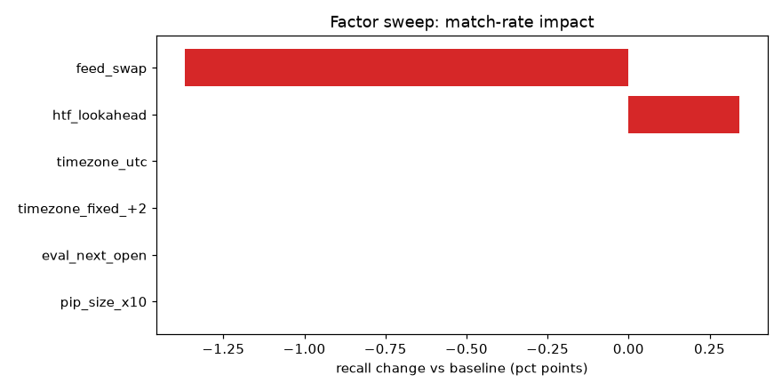
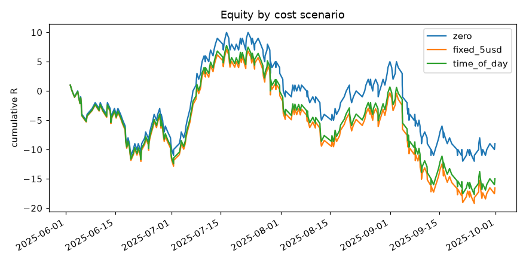
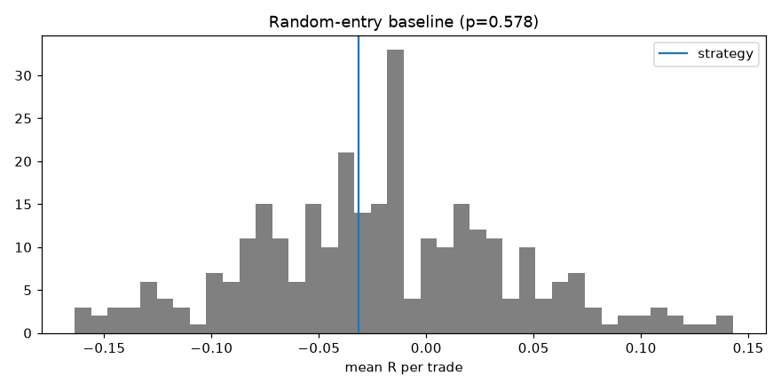
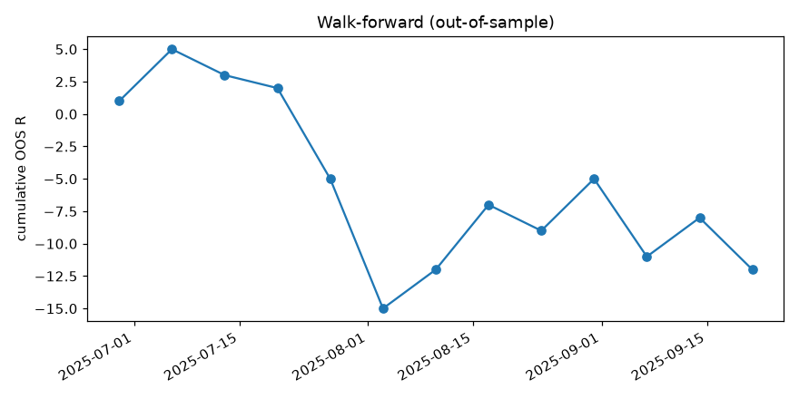

# HiFi Backtest report — Demo: EMA cross, BTCUSDT 15m, futures (reference) vs spot (candidate)

Rule `ema_cross` · bar `15min` · 2025-06-01 00:00:00+00:00 → 2025-09-30 23:45:00+00:00 (UTC) · tolerance ±1 bar(s)

## 1. Data quality

| feed | bars | start | end | gaps | weekend_gaps | unexpected_gaps | unexpected_missing_bars |
|---|---|---|---|---|---|---|---|
| reference | 11712 | 2025-06-01 00:00:00+00:00 | 2025-09-30 23:45:00+00:00 | 0 | 0 | 0 | 0 |
| candidate | 11712 | 2025-06-01 00:00:00+00:00 | 2025-09-30 23:45:00+00:00 | 0 | 0 | 0 | 0 |
| alternate | 11712 | 2025-06-01 00:00:00+00:00 | 2025-09-30 23:45:00+00:00 | 0 | 0 | 0 | 0 |

## 2. Signal parity (reference vs candidate)

| rule | ref | cand | matched | recall | precision | exact_time | median_price_diff_pips | side_mismatch |
|---|---|---|---|---|---|---|---|---|
| ema_cross | 292.000 | 287.000 | 281.000 | 0.962 | 0.979 | 0.922 | 48.070 | 0.000 |
| ALL | 292.000 | 287.000 | 281.000 | 0.962 | 0.979 | 0.922 | 48.070 | 0.000 |

Outcome of reference signals, matched vs unmatched (R):

| group | count | mean | impact_on_total_mean_R |
|---|---|---|---|
| matched | 281 | -0.060 |  |
| unmatched | 11 | -0.455 |  |
| ALL | 292 | -0.075 | -0.015 |

## 3. Factor sweep (one at a time, ranked by impact)

| factor | description | ref | cand | matched | recall | precision | exact_time | median_price_diff_pips | side_mismatch | recall_delta | precision_delta | impact |
|---|---|---|---|---|---|---|---|---|---|---|---|---|
| baseline | candidate feed, broker time, confirmed HTF | 292.000 | 287.000 | 281.000 | 0.962 | 0.979 | 0.922 | 48.070 | 0.000 | 0.000 | 0.000 | 0.000 |
| feed_swap | use the alternate feed instead of the candidate feed | 292.000 | 286.000 | 277.000 | 0.949 | 0.969 | 0.917 | 284.910 | 0.000 | -0.014 | -0.011 | 0.014 |
| htf_lookahead | HTF values taken from the still-forming bar (repaint) | 292.000 | 286.000 | 282.000 | 0.966 | 0.986 | 0.922 | 48.075 | 0.000 | 0.003 | 0.007 | 0.007 |
| timezone_utc | HTF/day buckets in UTC instead of broker NY+7 (DST-aware) | 292.000 | 286.000 | 281.000 | 0.962 | 0.983 | 0.925 | 47.990 | 0.000 | 0.000 | 0.003 | 0.003 |
| timezone_fixed_+2 | fixed UTC+2 server time (ignores DST) | 292.000 | 287.000 | 281.000 | 0.962 | 0.979 | 0.922 | 47.990 | 0.000 | 0.000 | 0.000 | 0.000 |
| eval_next_open | evaluate signal price at next bar open instead of close | 292.000 | 287.000 | 281.000 | 0.962 | 0.979 | 0.922 | 48.080 | 0.000 | 0.000 | 0.000 | 0.000 |
| pip_size_x10 | pip size 10x (common JPY / metals mistake) | 292.000 | 287.000 | 281.000 | 0.962 | 0.979 | 0.922 | 4.807 | 0.000 | 0.000 | 0.000 | 0.000 |

## 4. Performance (candidate feed, ATR-normalised)

| scenario | trades | mean_R | hit_rate | pf | total_R | mean_fwd_atr |
|---|---|---|---|---|---|---|
| zero | 287 | -0.031 | 0.484 | 0.939 | -9.000 | 0.526 |
| fixed_5usd | 287 | -0.058 | 0.484 | 0.891 | -16.571 | 0.526 |
| time_of_day | 287 | -0.052 | 0.484 | 0.901 | -15.014 | 0.526 |

### Random-entry baseline

Strategy mean R -0.031 vs random -0.022; percentile 42.3; one-sided p = 0.578 (300 sims, zero cost).

### Walk-forward

OOS total R: -12.00 over 13 windows; in-sample mean R 0.144 vs OOS -0.021.

| test_start | params | is_mean_R | oos_trades | oos_mean_R | oos_total_R |
|---|---|---|---|---|---|
| 2025-06-29 00:00:00+00:00 | {'fast': 9, 'slow': 34} | 0.067 | 11 | 0.091 | 1.000 |
| 2025-07-06 00:00:00+00:00 | {'fast': 9, 'slow': 34} | 0.067 | 14 | 0.286 | 4.000 |
| 2025-07-13 00:00:00+00:00 | {'fast': 9, 'slow': 34} | 0.167 | 8 | -0.250 | -2.000 |
| 2025-07-20 00:00:00+00:00 | {'fast': 9, 'slow': 21} | 0.246 | 19 | -0.053 | -1.000 |
| 2025-07-27 00:00:00+00:00 | {'fast': 9, 'slow': 21} | 0.212 | 23 | -0.304 | -7.000 |
| 2025-08-03 00:00:00+00:00 | {'fast': 5, 'slow': 55} | 0.222 | 16 | -0.625 | -10.000 |
| 2025-08-10 00:00:00+00:00 | {'fast': 5, 'slow': 55} | -0.036 | 13 | 0.231 | 3.000 |
| 2025-08-17 00:00:00+00:00 | {'fast': 13, 'slow': 34} | -0.061 | 7 | 0.714 | 5.000 |
| 2025-08-24 00:00:00+00:00 | {'fast': 13, 'slow': 34} | 0.023 | 10 | -0.200 | -2.000 |
| 2025-08-31 00:00:00+00:00 | {'fast': 13, 'slow': 34} | 0.105 | 12 | 0.333 | 4.000 |
| 2025-09-07 00:00:00+00:00 | {'fast': 13, 'slow': 55} | 0.355 | 12 | -0.500 | -6.000 |
| 2025-09-14 00:00:00+00:00 | {'fast': 13, 'slow': 34} | 0.282 | 9 | 0.333 | 3.000 |
| 2025-09-21 00:00:00+00:00 | {'fast': 13, 'slow': 34} | 0.220 | 12 | -0.333 | -4.000 |

## Notes

- Outcome model: entry next open, ±k·ATR target/stop, stop-first on ambiguous bars, horizon exit.
- Parity first, performance second: do not interpret performance until section 2 is ~95%+.